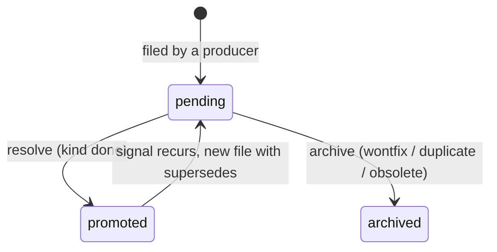

# Observations — lifecycle, identity, recurrence

Developer notes on how sabnyx tracks its notes about itself. Read
`SPEC.md` § [Observation schema](../SPEC.md#observation-schema) for the
field contract; this file explains why the code behaves as it does and
where to change it. The plans keep the design history:
[`jilog-borrowings.md`](plans/jilog-borrowings.md) (B1 identity, B2
recurrence) and
[`observations-and-age-triage.md`](plans/observations-and-age-triage.md)
(reader, transitions, closure). Where the shipped code differs from those
plans, see their *As built* sections:
[B1](plans/jilog-borrowings.md#b1--stable-observation-identity),
[B2](plans/jilog-borrowings.md#b2--resolution-kind-and-reopen-policy),
[companion](plans/observations-and-age-triage.md#as-built).

Examples below use synthetic slugs (`alpha-widget`, `beta-gadget`).

---

## 1. What an observation is

An observation is a small Markdown file in `vault/intake/.observations/`
that records something the vault noticed about itself: a page that is
referenced but missing (`gap`), two pages that disagree
(`contradiction`), a routing mistake, friction. Producers file them; the
operator reads and closes them.

Before this change there were three problems:

- **Counts disagreed.** Six call sites enumerated the folder themselves.
  Three of them (`services.vault_pulse`, which feeds `/status`, Telegram
  and the R1; `triage`; reweave's LLM context) counted archived files as
  pending.
- **No identity.** Producers avoided re-filing by filename globs
  (`*-gap-<slug>.md`) or in-memory pair sets. The glob matched any status
  and any writer.
- **No lifecycle.** Closing an observation meant hand-editing `status`. A
  signal that was fixed and came back looked the same as one the operator
  had dismissed.

Now there is one reader, a ledgered lifecycle, an identity for signals
that can be derived from the file, and a policy for what happens when a
signal recurs.

## 2. Lifecycle



- `status` is **derived** from `resolution_kind`, never set alone. The
  schema validator (`ObservationFrontmatter._status_matches_resolution`)
  is strict:
  - `pending`: none of `resolved`, `resolution`, `resolution_kind`;
  - `promoted`: all three, kind `done`;
  - `archived`: all three, kind `wontfix`, `duplicate` or `obsolete`.

  A hand-set `status: archived` without the three fields is malformed;
  lint says to revert it to pending and run the command.
- A transition never edits the body. It patches four frontmatter keys and
  appends one `observation.resolved` event.
- The `promoted → pending` edge is not the same file going back. The old
  file stays promoted; the recurring signal is written as a **new** pending
  file whose `supersedes` names the old one. An archived signal has no
  outgoing edge: recurrences are counted, not re-filed (§4).

Commands (actor `sabnyx-cli`):

```sh
uv run sabnyx observations list [--category C] [--status pending|promoted|archived|all]
uv run sabnyx observations resolve FILE --reason "page written"
uv run sabnyx observations archive FILE --kind duplicate --reason "same as the newer gap"
```

- `list` defaults to pending and sorts by (`observed`, filename). Columns:
  path, category, observed, age in days, the id's first 12 hex characters
  (or `—`), target, involves.
- A relative `FILE` is resolved against the **data root**, not the current
  directory, so a path pasted from `list` works. (`promote` resolves
  against the current directory; unifying the two is deferred.)
- `--reason` must be one non-empty line.
- `archive --kind done` is a usage error (exit 2): use `resolve`. A
  refusal exits 1 and writes nothing.

After a resolve, the frontmatter of a synthetic gap gains exactly these
lines (every other byte unchanged):

```yaml
status: promoted          # replaced in place
resolved: 2026-01-15      # appended before the closing ---
resolution: 'page now exists: alpha-widget'
resolution_kind: done
```

## 3. Identity

**Plain version.** Two observations are "the same signal" when they point
at the same thing in the same way: a contradiction between the same two
pages, or a gap for the same missing page. Titles and bodies are written by
models and people and are never compared.

**Precisely.** `observations.obs_id(meta, resolver)` returns
`sha256:<64 hex>` = `ledger.content_hash({"category": c, "signal": s})`,
or `None`. The signal (`observations.signal`) exists only when **all** of
these hold:

1. `source_agent` is one of the trusted local writers
   (`IDENTITY_SOURCES`: `sabnyx-scan`, `sabnyx-entities`,
   `sabnyx-reweave`, `sabnyx-tend`, `sabnyx-cli`, `sabnyx-ingest`,
   `manual`). The line is local vs remote: the remote channels
   (`sabnyx-telegram`, `sabnyx-r1`, `sabnyx-ingest-web`) confer no
   identity.
2. Either a `contradiction` with exactly two `involves` that normalise to
   two distinct slugs, giving the signal sorted `[a, b]`; or a `gap` with a
   `target` that normalises to a slug.

Everything else is **prose**: it gets the lifecycle commands but no dedupe
and no reopen.

The id is **computed on every read and never stored** (`observations.py`
DEC-003). It depends on the vault's page names: adding an alias can move a
token to its page. A stored id would go stale silently. Ids appear only in
ledger payloads, as point-in-time snapshots.

### Normalising one token

`_component(value, resolver)` turns one `involves` or `target` token into
a slug, or `None`:

| Step | Input → output |
|---|---|
| strip | `'  beta-gadget '` → `'beta-gadget'` |
| unwrap a full wikilink | `'[[alpha-widget\|Alpha]]'`, `'[[alpha-widget#h]]'` → `'alpha-widget'` |
| keep the last `/` segment | `'atlas/concepts/alpha-widget.md'` → `'alpha-widget.md'` |
| strip `.md` (any case) | `'alpha-widget.md'` → `'alpha-widget'` |
| empty → `None` | `'[[]]'`, `'foo/.md'` → `None` |
| look up (below) | Found → the page's slug; Ambiguous → `None`; Missing → `slug_fold(token)` |

So `atlas/concepts/alpha-widget.md`, `alpha-widget.md` and `alpha-widget`
are one signal component. The order exists because `slugify` has four
traps: `slugify('')` is `untitled-<hash>`, `slugify('Foo.md')` is
`foo-md`, a path slugifies to `atlas-people-foo`, and two long names
collide at the default length of 80. The Missing branch uses `slug_fold`,
which returns `None` for a token with no slug-able content (`'!!!'`), so
junk never becomes an indexable identity.

Tokens are never used as paths: they reach only `_component` and
`lookup`, never `Path`, `open` or `fm.load` (a test tracks opens).

### `lookup`: what a name points to

`lookup(token, resolver)` returns `Found(slug)`, `Ambiguous(claimants)`
or `Missing()`. The `Resolver` holds two maps built from every vault page:
**stem claims** (`slug.lower()` and `slugify(slug)`, the same keys
`context.link_resolution_index` registers) and **alias claims**. The first
of these keys with any claimant decides:

1. `stem[token.strip().lower()]`
2. `stem[slugify(token)]`
3. `alias[slugify(token)]`

One claimant is Found; two or more is Ambiguous and never guessed. So a
stem beats any alias, an alias claimed by two pages is ambiguous, and two
stems that slugify alike (`Foo Bar.md`, `foo-bar.md`) are ambiguous. The
two maps are kept apart because a merged map cannot tell which claimant
owns the stem. The same rule serves identity, gap closure and health
(`observations.py` DEC-002), so "this page exists" means one thing
everywhere.

## 4. Recurrence policy

When a producer proposes an identity-bearing observation,
`write_observation` rebuilds the index and asks
`recurrence_policy(index, obs_id)`. The four checks run in this order:

| # | State of the id | Outcome | Writes |
|---|---|---|---|
| 1 | a pending record exists | `already_pending` | nothing |
| 2 | chain head has kind `done` | `reopened` | new pending file, `supersedes: <head rel>`, `observation.created` |
| 3 | chain head has another kind | `suppressed` | nothing per write; one `observation.suppressed` per id per run |
| 4 | no record | `written` | new pending file, `observation.created` |

Prose observations skip the policy. They are written, or reported as
`exists` if their filename is taken.

- **The chain head** is the resolved record that no same-id record
  `supersedes` (`observations.py` DEC-004). Filename order cannot be used:
  `foo-2.md` sorts before `foo.md` because `-` (0x2d) sorts before `.`
  (0x2e), so "latest by name" picks the oldest file. Ties break on the
  latest (`resolved`, `observed`, path) and are reported by health. If
  every record of an id is superseded (a forged cycle), every resolved one
  is a candidate. The id never falls back to "new", which would re-file a
  dismissed signal.
- **Filenames** are `<observed>-<category>-<slug(title)>.md`. An
  identity-bearing write that collides takes the first free `-2` … `-99`;
  beyond that it is `invalid`. A prose collision is `exists`. The suffix is
  deterministic (no timestamps) so report goldens stay stable.
- **Suppressions are counted per run**, not per write (`writers.py`
  DEC-002). A run is one entry-point call: `entities gaps`, `scan`, one
  ingest apply, one `reweave_one`. Each hands its outcomes to
  `ledger_suppressed`, which appends one event per id with
  `{obs_id, count, kind}` and nothing when the count is zero. A signal that
  keeps firing against a `wontfix` is visible in the ledger without being
  re-filed.
- **`supersedes` cannot be supplied.** `write_observation` has no
  parameter for it, the LLM output schema forbids extra fields, and no CLI
  flag sets it. Only the reopen path writes it.
- **Dry runs go through the real policy**, so a preview cannot disagree
  with the real run. `scan` uses this: a dry pass, a dedupe of identical
  pairs within one LLM result, the operator's confirm, then a real pass
  over the confirmed and suppressed findings.

`WriteOutcome.kind` is one of `written | reopened | already_pending |
suppressed | exists | invalid`, and carries the path it is about (`writers.py`
DEC-001). Callers can count and report without re-reading the folder.

## 5. Gap closure

A gap with a `target` closes itself once that page exists.
`writers.close_resolved_gaps` takes every pending gap whose target
`lookup` returns Found and calls `transition_observation(kind="done",
reason="page now exists: <slug>")`. The file change and the ledger event
are therefore identical to a manual `observations resolve`.

- Runs at the start of `entities gaps` (actor `sabnyx-entities`) and in
  `tend` after reweave and before the health summary (actor
  `sabnyx-tend`), so the reported pending count is never stale. In `tend`
  it runs even with `--no-health`; `--dry-run` previews what would close.
- An Ambiguous target is left pending, and the claiming pages are printed.
  Gaps without a target (legacy or prose) and Missing targets are not
  touched.
- A refused gap (for example a file the patcher cannot edit safely) is
  reported and the run continues; infrastructure errors propagate.
- The AGENTS.md role is health-agent.
- Ledger: `entities.gaps_scanned` fires on every non-dry run (including a
  run with no candidates) with `closed` and `ambiguous` counts;
  `tend.completed` carries `gaps_closed`.

## 6. Transitions and ledger failures

`writers.transition_observation(path, *, kind, reason, actor,
dry_run=False)` runs these steps in order. Each refusal raises
`ObservationRefused(reason, detail)` and touches nothing; the CLI prints
`refused (<reason>): <detail>` and exits 1.

1. **Path:** `resolve()` must give a regular `.md` file directly inside
   `vault/intake/.observations/`, else `outside` / `not_found`. This
   stops `..` and symlink escapes. A symlink loop is `not_found`.
2. **Reason:** stripped, non-empty (`empty_reason`), one line by
   `str.splitlines` (`multiline_reason`; this catches all eight break
   characters, where `"\n" in r` misses six), valid UTF-8
   (`unencodable_reason`).
3. **Parse** the raw bytes (CRLF intact; else `malformed`) and require
   `pending` (else `not_pending`).
4. **Snapshot** the `obs_id` for the event.
5. **Patch** with `fm.patch_frontmatter`.
6. **Re-validate** the patched text strictly; a failure raises
   `RuntimeError` and writes nothing.
7. **Write** atomically (`fm.write_text_atomic`), then append
   `observation.resolved` (plane `event`): `{category, old_status,
   new_status, kind, resolution}` plus `obs_id` and `target` when set.

**The patcher** (`fm.patch_frontmatter`) exists because a load-and-dump
round-trip through python-frontmatter writes keys in alphabetical order,
so it would rewrite unrelated lines of every hand-written file. Instead it
replaces the column-0 `status:` line in place, appends the three resolution
keys before the closing fence (one `yaml.safe_dump` line each), copies
every other byte (CRLF, leading whitespace), and splits only on `"\n"` to
match the library's fence regex. It then checks its own output: if the
re-parse is not the input plus exactly the updates, it raises `PatchError`
(refused `malformed`).

**Ledger failure.** The file is written first and the ledger second, and
the file is restored only if the ledger line **cannot** be on disk:

| Failure | Exception | File | Retry |
|---|---|---|---|
| before the first `write(2)`: `OPS.mkdir`, event construction, `open`, or a Ctrl-C | the original one (a Ctrl-C stays a `KeyboardInterrupt`) | restored to its original bytes | works |
| from the first `write(2)` through `close`, and the first append's directory sync: short write, any exception from `write` / `fsync` / `close` / the directory sync (except its swallowed `OSError`) | `LedgerWriteError` | stays resolved | refused `not_pending` |
| a Ctrl-C in that same region | `LedgerWriteInterrupted` (a `KeyboardInterrupt`) | stays resolved | refused `not_pending` |
| restore itself fails | `RuntimeError` chained to both | stays resolved, no event | refused `not_pending` |

The restore runs on any exception or interrupt that arrives before the
first `write(2)`. Other `BaseException`s (`SystemExit`, `GeneratorExit`) are
not classified and do not restore.

This is the contract for every command that mutates a file and then
appends (today only transitions implement the restore); see
[ADR 0008](decisions/0008-ledger-append-failure-semantics.md). Both
leftover states (a non-pending file with no `observation.resolved` event
for its path) are what a future `reconcile` check detects.

## 7. Invariants, failure modes, accepted edges

**Invariants** (each pinned by tests):

- Only `observations.load_all()` enumerates the folder
  (`tests/test_source_guards.py::test_only_the_reader_enumerates_observations`).
  Every count is pending-only; malformed files (bad YAML, schema
  failure, not UTF-8) are reported by `health` and `triage` and never
  counted.
- `observations.py` never writes and never imports `writers`. Imports
  point one way: commands → `writers` → `observations` → `fm` / `context`
  / `schemas` / `ledger`.
- Every observation mutation goes through `writers.py` and appends one
  ledger event: `observation.created`, `observation.resolved`, or (once
  per id per run) `observation.suppressed`.
- YAML is parsed with `safe_load` only, through an explicit handler at
  every parse site (source guards in `tests/test_source_guards.py`).
- An id that has a resolved record never falls back to "new"; `index()`
  raises rather than let it happen.

**Health warnings** (`observations.integrity_warnings`; warnings, not
failures): `duplicate_pending`, `multi_head`, `dangling_supersedes`,
`mismatched_supersedes`, `ambiguous_alias`, `ambiguous_stem`. Output is
sorted with fixed wording, so it can serve as a report golden.

**Accepted edges.** In each case the failure is a duplicate or a visible
leftover, never a silently lost signal:

- **Id drift.** A pending signal's id moves when a page or alias is
  created for one of its tokens. A Found component is the page's lowercased
  stem, a Missing one is `slug_fold(token)`, and these differ only for an
  off-spec (non-kebab) stem. Renaming a page without adding an alias makes
  its recurring signals new. Result: a duplicate, never a false merge.
- **Legacy gaps.** Old gaps named `*-gap-<slug>.md` have no `target`,
  so they are prose and no longer suppress `entities gaps`. When a new
  targeted gap duplicates one, archive the legacy file with
  `observations archive --kind duplicate`.
- **Prose has no identity.** Hand-filed contradictions and gaps
  (`sabnyx new`) are prose until `new --involves/--target` exists.
- **No lock between a transition's read and its write.** A concurrent
  hand edit of the same file can be overwritten by the write or by the
  restore.
- **Interrupted append.** A Ctrl-C after the ledger write began is
  `LedgerWriteInterrupted` and correctly not restored: the file stays
  resolved, with an event only if the line landed. ENOSPC with zero bytes
  written is classified conservatively as `LedgerWriteError` and always
  leaves a resolved file with no event. A Ctrl-C during the restore itself
  also leaves the file resolved with no event.
- **A lone surrogate in model-supplied `involves`** writes a valid pending
  file whose `observation.created` cannot serialise.
- **A forged `supersedes` cycle beside a live chain tip** of the same id is
  not reported by health. The policy stays safe.
- **Cost.** `resolver()` walks every vault page on every write, transition
  and `list`. `vault_pulse` parses every observation file per `/status`
  poll, and `/status` has no rate limit. Fine at tens of files; an mtime
  cache is the fix if it ever matters.
- **Fixture-only branches.** `lookup`'s Ambiguous branch and gap closure
  are proven by fixture tests only.

The open items are tracked in one place:
[Deferred from Cycle 1](plans/jilog-borrowings.md#deferred-from-cycle-1-the-one-list).
The trust reasoning (why remote channels get no identity) is in the plan's
[threat pass](plans/jilog-borrowings.md#threat-pass--every-cycle).

## 8. Decisions

The ones that shape the code. The `DEC-n` tags are the `@decision`
annotations next to the code.

| Decision | Choice | Why | Rejected |
|---|---|---|---|
| Identity scope | derivable signals only (two-page contradiction, targeted gap) | a false merge drops a signal silently; a duplicate is visible | hashing titles; identity for any producer |
| Where the id lives | computed on every read (`observations.py` DEC-003) | it depends on page names, which change | storing `obs_id` in frontmatter |
| Who gets identity | `IDENTITY_SOURCES`, by code-set `source_agent` (`observations.py` DEC-001) | injected remote content must not suppress or reopen a trusted signal | gating on `SABNYX_TRUSTED_SOURCES`, whose default would strip identity from `scan` and `entities` |
| `producer` field | audit only, outside the hash | one signal from two producers should merge; `scan` stays suppressed by reweave's contradictions | `producer` in the hash; deriving it from `source_agent` (`tend` runs several producers) |
| Status vs kind | status derived, strict validator | the "archived without a kind" state becomes unrepresentable | a free status × kind matrix |
| Gap closure | a resolve (kind `done`), in `entities gaps` and `tend` | only `done` reopens; a stale pending count is the bug being fixed | archiving on closure; closing only in `entities gaps` |
| Chain head | follow `supersedes` (`observations.py` DEC-004) | filename sort picks the oldest file | latest filename |
| Ambiguity | never guessed; stem beats alias (`observations.py` DEC-002) | identity, closure and health must agree | first match wins |
| Writer result | six-kind `WriteOutcome` (`writers.py` DEC-001) | the old `None` hid lost signals among deliberate skips | `str \| None` |
| Suppression counting | one event per id per run (`writers.py` DEC-002) | no state threaded through producers; no ledger spam | one event per write; a context manager |
| Frontmatter edits | own patcher | a round-trip reorders keys | python-frontmatter load/dump |
| Ledger failure | restore iff the line cannot be on disk (`writers.py` DEC-003, [ADR 0008](decisions/0008-ledger-append-failure-semantics.md)) | the ledger must never record a mutation that was undone | restore on any ledger error; never restore |
| Clock | `ledger.today()`, UTC | one seam, timezone-independent goldens | `date.today()` |
| Index caching | rebuilt per call | correct by construction at this size | an mtime cache (available later) |

## 9. Code map

| Where | What |
|---|---|
| `src/sabnyx/observations.py` | read-only library: `load_all`, `observations`, `Resolver` / `lookup` / `_component` / `signal` / `obs_id`, `index` / `ObsIndex`, `recurrence_policy`, `closable_gaps`, `integrity_warnings` |
| `src/sabnyx/writers.py` | every observation mutation: `write_observation`, `ledger_suppressed`, `transition_observation`, `close_resolved_gaps` |
| `src/sabnyx/commands/observations.py` | the `list` / `resolve` / `archive` CLI; builds no frontmatter itself |
| `src/sabnyx/fm.py` | `patch_frontmatter`, `write_text_atomic`, the safe YAML handler |
| `src/sabnyx/schemas.py` | `ObservationFrontmatter`, `Producer`, `ResolutionKind` |
| `src/sabnyx/context.py` | `link_candidates` (stem and alias claims) |
| `src/sabnyx/ledger.py` | `today()`, `LedgerWriteError` |

Producers and the `producer` value they write:

| Code path | `producer` | `source_agent` |
|---|---|---|
| `commands/entities.py` (`entities gaps`) | `entities` | `sabnyx-entities` |
| `commands/scan.py` | `scan` | `sabnyx-scan` |
| `commands/reweave.py` (`reweave_one`, also run by `tend`) | `reweave` | `sabnyx-reweave` or `sabnyx-tend` |
| `services.py` ingest (CLI, Telegram, R1, web) | `ingest` | the channel's actor |
| `commands/new.py` | `manual` | `sabnyx-cli` |

Readers: `services.vault_pulse` (`/status`), `commands/triage.py`,
reweave's context, `commands/health.py`, `commands/tend.py`.

Where to start: read `recurrence_policy` and `index` in `observations.py`,
then `write_observation` in `writers.py`. The tests mirror the modules:
`tests/test_observations_identity.py`, `test_writers_observation.py`,
`test_writers_transition.py`, `test_gap_closure.py`,
`test_health_integrity.py`, `test_fm_patch.py`.

**Adding a producer:** call `write_observation` with a new `Producer`
value and a code-set `actor`, collect the outcomes, and call
`ledger_suppressed` once at the end of the run. Add the actor to
`IDENTITY_SOURCES` only if its input is trusted.
